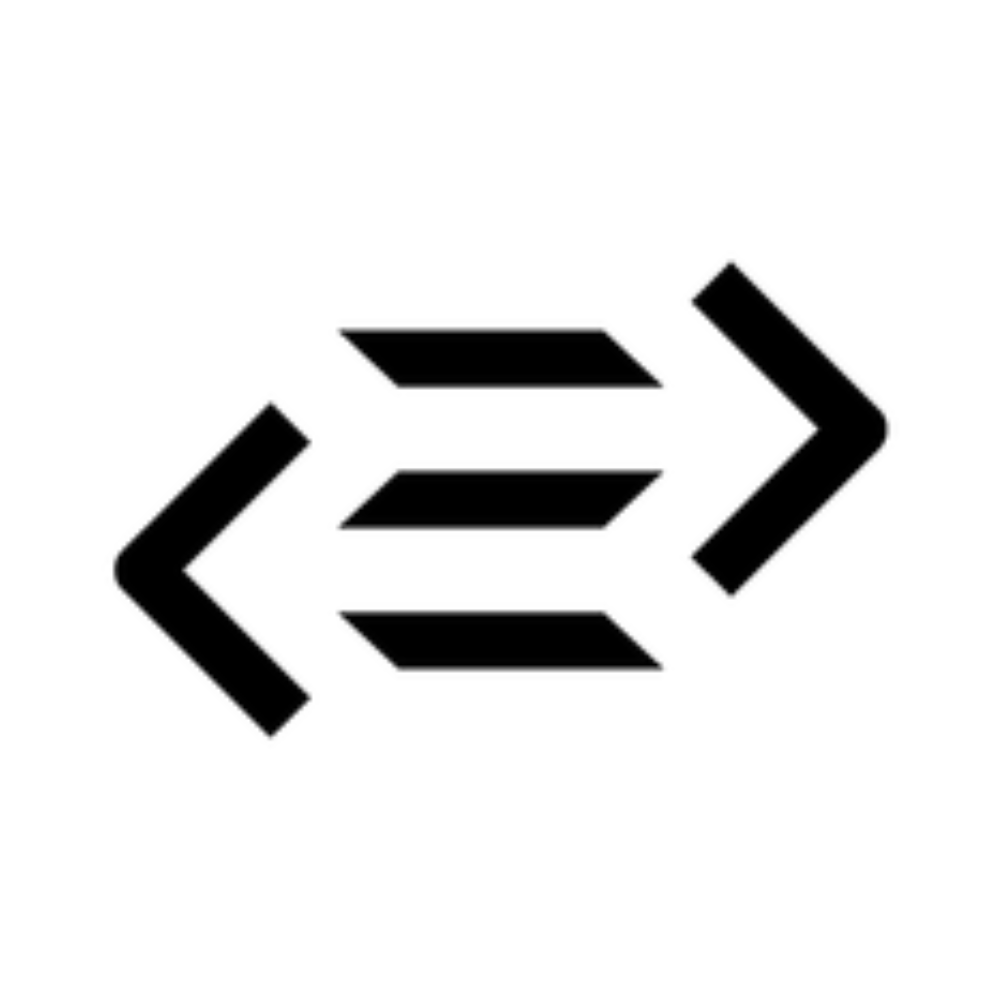
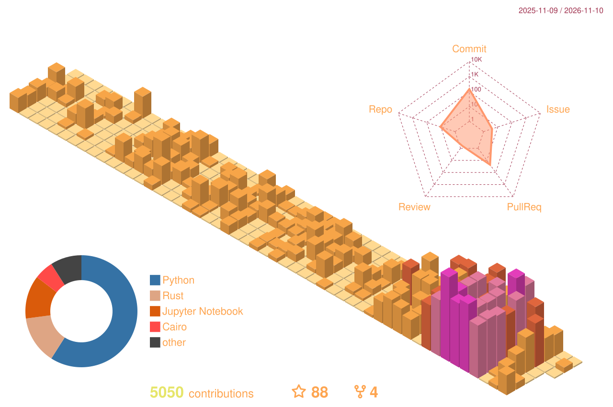

- 👋 Hi, I’m @Yashiru
- 🔧 Backend & systems engineer: I build the software that sits between physical machines and the people who rely on them, from drone fleets to GPU clusters
- ⚡ Working with Python, TypeScript and Rust on backends, data pipelines and device orchestration, and going down to CUDA when the hardware needs it
- 🔬 Happiest when my code drives something real, and the data coming back has to be right
- 💞️ I’m looking to collaborate on automation, data infrastructure, or any project that connects software to real hardware
- 📫 How to reach me ?
    - 📧 [fasanol.info@gmail.com](mailto:fasanol.info@gmail.com)
 

    

 

<!-- Main stack — backends, data and device orchestration -->

    
    
    
    
    

<!-- Low-level background -->

    
    
    
    
    

<!-- 
 
 
 

    

 -->
